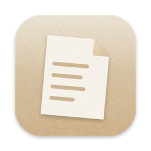
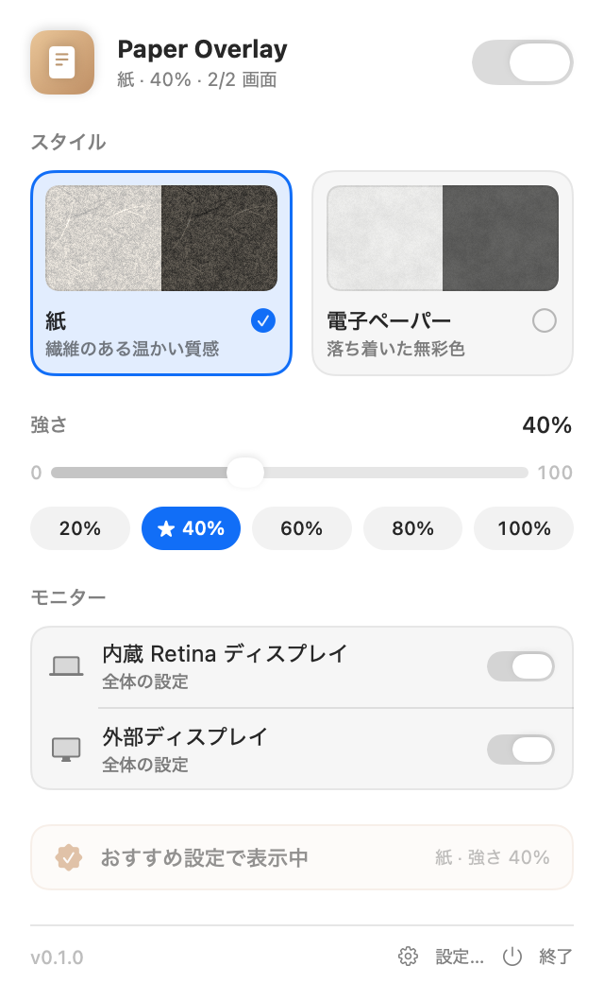
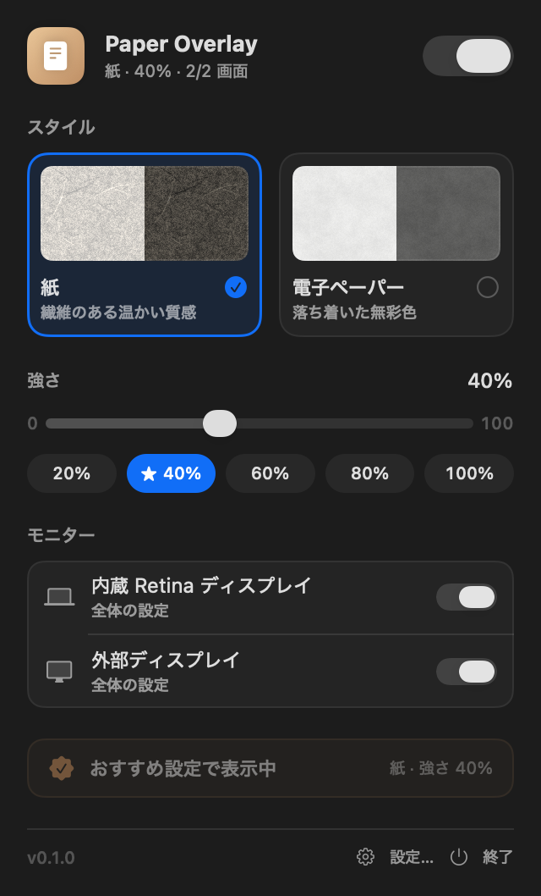

<p align="center">
  
</p>

<h1 align="center">Paper Overlay</h1>

<p align="center">
  Mac の画面全体に、紙のような質感を重ねるメニューバーアプリ
</p>

---

画面のぎらつきや強いコントラストを和らげ、画面を紙のような落ち着いた見た目にします。
マウスやキーボードの操作はそのまま下のアプリに届くので、普段どおりに作業できます。

> [!NOTE]
> このアプリは [Paperman](https://paperman.cc/) にインスパイアされて作った、個人の非公式プロジェクトです。
> Paperman やその開発元とは関係ありません。コード・テクスチャ・アイコンはすべて独自に作っています。

<p align="center">
  
  &nbsp;
  
</p>

## 機能

- **2 種類の質感**
  - **紙**：細かい粒と、ゆるく曲がった繊維のある、暖かい紙の質感
  - **電子ペーパー**：明るい無彩色のグレーに、ごく弱い粒とゆるやかなまだら
- **強さの調整**：0〜100% のスライダーと、20・40・60・80・100% のプリセット（おすすめは 40%）
- **マルチモニター**：表示するモニターを選べるほか、モニターごとに質感と強さを個別に設定できる
- **クリックスルー**：オーバーレイはクリックやフォーカスを奪わない
- **他のアプリのフルスクリーン中にも表示**（サンドボックスを使わない直接配布のため）
- **スクリーンショットや画面共有には写らない**（リリースビルド）
- **ログイン時に起動**
- **軽い**：メモリ約 24MB、待機中の CPU 0%（Apple Silicon・モニター 2 台で計測）
- 画面の中身を読み取らず、ネットワークにも接続しない。画面収録やアクセシビリティの許可は不要

## 目への効果について

このアプリは、**画面を落ち着いた見た目にするための、好みと快適さのためのツール**です。
「目の疲れを防ぐ」「目に優しい」といった医学的な効果はうたっていません。

画面に重ねたテクスチャは、コントラストを少し下げて粒を加えます。ただし、画面のガラス面での映り込みを減らす物理的な反射防止フィルムとは仕組みが違います。
ソフトウェアで重ねるテクスチャが目の疲れを減らすことを直接示した研究は、作者が調べた範囲では見つかっていません。

## 動作環境

- macOS 26 以降（Apple シリコン・Intel の両方に対応）
- ソースからビルドする場合は Xcode 26 と [XcodeGen](https://github.com/yonaskolb/XcodeGen) が必要

## インストール

[Homebrew](https://brew.sh/) で入れられます。

```bash
brew install --cask aoki-dai/tap/paper-overlay
```

[Releases](https://github.com/Aoki-Dai/paper-overlay/releases) から zip をダウンロードし、`PaperOverlay.app` を「アプリケーション」フォルダに入れてもかまいません。

### 初めて開くとき

このアプリは Apple の Developer ID で署名していないため、最初は macOS に開くのを止められます。

1. `PaperOverlay.app` を開こうとする（「開けません」と表示されたら「完了」で閉じる）
2. 「システム設定」→「プライバシーとセキュリティ」を開き、下のほうにある「このまま開く」を押す

2 回目からは普通に開けます。

## ソースからビルドする

```bash
brew install xcodegen
git clone https://github.com/Aoki-Dai/paper-overlay.git
cd paper-overlay
xcodegen generate
open PaperOverlay.xcodeproj
```

Xcode で `PaperOverlay` スキームを選んで実行すると、メニューバーにアイコンが出ます。
コマンドラインでビルド・テストする場合：

```bash
xcodebuild -project PaperOverlay.xcodeproj -scheme PaperOverlay -destination 'platform=macOS' test
```

`.xcodeproj` は `project.yml` から生成するので、リポジトリには含めていません。

## 使い方

- メニューバーのアイコンをクリックすると、設定パネルが開きます
- `⌘,`（パネルの「設定…」）で設定ウインドウを開くと、ログイン時の起動、モニターごとの設定、パネルの表示項目を変えられます

## 仕組み

- モニターごとに、枠なし・透明・クリックスルーの `NSWindow` を最前面に重ねています
- テクスチャは起動時にプログラムで生成しています（周期の違うバリューノイズを重ねる、SVG の `feTurbulence` と同じ考え方）。画像ファイルは使っていません
- タイルは Retina の解像度（512px = 256pt）で作り、1 画素が 1 物理ピクセルになるようにしています

```txt
PaperOverlay/
  App/        エントリポイント（MenuBarExtra と設定ウインドウ）
  Overlay/    オーバーレイのウインドウ、テクスチャ生成、モニター情報
  Settings/   設定の保存、ログイン時の起動
  UI/         設定パネルと設定ウインドウ（SwiftUI）
PaperOverlayTests/   Swift Testing によるテスト
```

## ライセンス

[MIT License](LICENSE)
